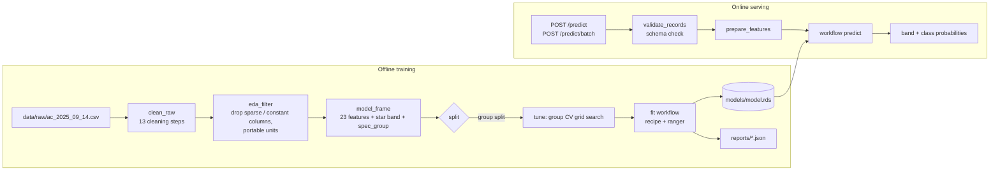

# AC Energy Star-Rating Classifier

Predicts whether an air conditioner's cooling star rating is **low (≤ 2.5★), mid (≤ 4★) or high (> 4★)** from a
handful of its test measurements, using the Australian Government's open Energy Rating dataset. Delivered as an R
package with a reproducible cleaning pipeline, a single preprocessing + model artifact, a CLI and a REST API.

**Key finding.** The original analysis reported a test Macro-F1 of **0.953**. Reproducing it from the raw data
shows the score is inflated by split leakage: **60% of rows share an exact twin** (the same unit registered under
several model numbers), so a random 80/20 split puts **58% of test rows' twins in the training set**. Keeping twins
on the same side of the split drops Macro-F1 to **0.881 ± 0.052** (5 splits). An earlier version that left the
sibling star ratings in the inputs scored **0.993**, which is target leakage.

## Key Features

- **Faithful reproduction.** The 13-step cleaning was ported and reproduces the original cleaned table
  (4,759 × 80) with **0 differing cells**; the original caret model was re-run from the raw CSV and gives test
  Macro-F1 **0.952** vs the reported **0.953** (same test split, one of 950 rows differs).
- **Leakage-aware evaluation.** Group-aware train/test split and group cross-validation on identical
  specifications (twin overlap **58% → 0%**), with a 5-seed ablation that measures each effect.
- **One artifact for training and inference.** A tidymodels `workflow` (recipe + ranger forest) saved as a single
  **1.43 MiB** `.rds`; one `prepare_features()` function normalises inputs in both paths, so a single-row request
  produces the same feature width as training (tested).
- **Validated REST API.** plumber service with per-field type/range checks, rejection of unknown fields, batch
  limit (413), 503 without a model, and OpenAPI docs; p50 latency **34 ms** per request.
- **Tested.** **58 tests / 225 expectations** (unit + integration incl. a live HTTP server), **96.5%** line
  coverage, **0** lintr findings.

## System Architecture



Preprocessing inside the saved workflow (fitted on training rows only):

| Step | What it does | Why |
|---|---|---|
| `step_zv` | drop zero-variance predictors | no signal |
| `step_novel` / `step_unknown` | map unseen and missing brands to their own levels | robust inference on new brands |
| `step_other` (2%) | pool rare brands into `other` | avoid one-off levels |
| `step_dummy` (one-hot) | encode brand | numeric input for SMOTE / forest |
| `step_impute_median` | fill missing heating-season values | 15–29% missing in some columns |
| `step_smote` (ratio 1.5) | oversample minority bands | training only; skipped at prediction |
| `step_center` / `step_scale` | standardise | kept from the original recipe |

## Tech Stack


| Area | Tools |
|---|---|
| Data | readr, dplyr, tidyr, stringr |
| Modelling | recipes, themis (SMOTE), parsnip + ranger, workflows, rsample, tune, yardstick |
| Serving | plumber (OpenAPI docs), jsonlite, logger |
| Configuration | config (YAML profiles) + `APP_*` environment variables / `.env` |
| Quality | testthat, covr, lintr, styler, roxygen2 |
| Environment | renv (project-local library, `renv.lock`), Docker + docker compose |
| Original method (reproduction only) | caret, kernlab, glmnet, kknn, MASS |

## Quick Start

Requires R ≥ 4.3 (developed on 4.6.2). Clone the repository:

```bash
git clone https://github.com/daniel880830/ac-star-rating-classifier.git
cd ac-star-rating-classifier
```

Restore the project library (installs into `renv/library`, not your global R library):

```bash
Rscript -e "renv::restore()"
```

Create your settings file (all paths and API settings can be overridden with `APP_*` variables):

```bash
cp .env.example .env
```

Train the leakage-aware model (tunes on the first run, about 2 minutes on 16 threads):

```bash
Rscript exec/acstar.R train
```

Start the API on `http://127.0.0.1:8080` (docs at `/__docs__/`, `/` redirects there):

```bash
Rscript exec/acstar.R serve
```

Call it:

```bash
curl -s -X POST http://127.0.0.1:8080/predict -H "Content-Type: application/json" -d '{"brand":"MITSUBISHI ELECTRIC","rated_aeer":4.2,"eertestavg":4.3,"c_power_inp_rated":0.6,"residential_hspf_hot":5.6,"commercial_hspf_hot":5.4,"pia_inoperative_power":2.5,"commercial_hspf_mixed":4.6,"rated_acop":4.4,"commercial_hspf_cold":3.9,"coptestavg":4.5,"residential_hspf_cold":4.1,"residential_hspf_mixed":4.9,"rated_total_cool_capacity_w":2500,"c_total_cool_rated":2.5,"t1_half_cap_power_rated":240,"commercial_thec_hot":120,"residential_thec_hot":180,"h_power_inp_rated":0.7,"low_temp_cooling_half_cap_power_rated":220,"residential_thec_mixed":900,"commercial_thec_mixed":450,"h1_half_cap_power_rated":300}'
```

Other commands:

| Command | What it does |
|---|---|
| `Rscript exec/acstar.R train --profile original` | original method (random split) → `models/model_original.rds` |
| `Rscript exec/acstar.R tune` | grid search only → `reports/tuning_<profile>.json` |
| `Rscript exec/acstar.R ablation --seeds 5` | leakage experiments → `reports/ablation.json` |
| `Rscript scripts/reproduce_original.R [--all-models]` | the original caret code, end to end |
| `Rscript -e "devtools::test()"` / `Rscript scripts/coverage.R` | tests / coverage |

### Docker

One command trains the model in a container, then starts the API once training succeeded:

```bash
docker compose up --build
```

The API is published on `API_HOST_PORT` from `.env` (default 8080; the container listens on 8000).

Verified with `docker compose up --build`: training exits 0, the API reports `healthy`, `/predict` and
`/predict/batch` return 200, invalid input returns 422, malformed JSON 400, and the process runs as the non-root
user `app` (uid 10001).

| Image | Size | Change |
|---|---|---|
| Runtime on `rocker/r-ver:4.6.2` (help pages, tests and headers already removed) | 1.68 GB | – |
| Runtime on `ubuntu:26.04` with R copied from the builder, only the shared libraries found by `ldd`; R manuals, X11/cairo devices and Tcl/Tk removed | **595 MB** | −65% |

The `rocker/r-ver` base alone is 1.5 GB because it carries compilers for source installs; the runtime does not
need them. Inside the builder, the package library shrinks from 199 MB to 107 MB and R itself from 112 MB to
72 MB. A build-time `ldd` check fails the build if any shared library is missing.

Training inside the container gives the same result as on Windows to six decimals (Macro-F1 0.816472, identical
confusion matrix), as expected with the same `renv.lock` versions and seeds.

## Evaluation & Benchmarks

### Model metrics

Test set metrics with 95% stratified-bootstrap intervals (1,000 replicates). Bands: low 54%, mid 37%, high 9%.

| Model | Split | Test Macro-F1 | Kappa | Accuracy | CV Macro-F1 |
|---|---|---|---|---|---|
| Original report | random | 0.953 [0.933, 0.969] | 0.928 | 0.960 | 0.941 ± 0.009 |
| Original caret code, re-run | random | 0.952 [0.932, 0.969] | 0.927 | 0.959 | 0.943 ± 0.009 |
| tidymodels port, `original` profile | random | 0.953 [0.937, 0.968] | 0.911 | 0.951 | 0.941 ± 0.010 |
| **tidymodels, `default` profile (served)** | **group** | **0.816 [0.785, 0.847]** | **0.771** | **0.872** | **0.900 ± 0.018** |

Per-class results of the served model: low F1 0.931, mid 0.825, **high 0.693** (precision 0.897, recall 0.565):
the high band is where the inflated score was hiding.

### Leakage ablation

Same forest settings (mtry 6, min_n 1, gini, 500 trees) for every row; mean ± sd over 5 split seeds.
"Twin overlap" is the share of test rows whose exact predictor vector also appears in training.

| Experiment | Features | Twin overlap | Macro-F1 | Kappa |
|---|---|---|---|---|
| All columns, incl. sibling star ratings and TCSPF (first analysis) | 78 | 55.0% | 0.993 ± 0.002 | 0.992 |
| Original: random split | 23 | 58.0% | 0.952 ± 0.006 | 0.925 |
| Group split on identical specifications | 23 | 0.0% | 0.881 ± 0.052 | 0.828 |

The spread across seeds grows sharply once twins are separated (sd 0.006 → 0.052): with only ~400 high-band rows
in ~2,700 distinct specifications, which units land in the test set matters, and a single random split
overstates both the score and its precision.

### Issues found in the original analysis

| # | Issue | Impact (measured) |
|---|---|---|
| 1 | Sibling star ratings (`c_star_cold/hot`, r = 0.98 / 0.93 with the target) and the TCSPF formula inputs left in the predictors | Macro-F1 0.993 instead of 0.952: target leakage |
| 2 | Random split although 60% of rows have an exact twin | 58% of test rows memorised; Macro-F1 0.952 → 0.881 with a group split |
| 3 | The "\|r\| > 0.8" leakage filter was computed but never applied | none on this data: after removing the listed leakage columns the largest \|r\| is 0.725 (Rated AEER) |
| 4 | Brand leakage check looked for column `brand`, the column is `Brand` | the check never ran |
| 5 | Feature selection (ANOVA, chi-square, RF importance) used all rows before the split | not quantified |
| 6 | Feature-selection scores: `-log10(0) = Inf` breaks min–max normalisation, and mutual information was wrapped in `capture.output()`, so it became `NA` | categorical features could never be selected; `Brand` was added by hand |
| 7 | The modelled 23 features differ from the selection output (+Brand, +2 `thec_mixed`, −3 others) | documented; the 23 modelled features are kept for comparability |
| 8 | Phase merge compared `"Three-Phase"`, the raw value is `"Three-phase"` | 28 rows kept as a separate level (`fix_phase_bug = TRUE` fixes it) |
| 9 | Report says high = "≥ 4.0", `cut(right = TRUE)` puts 4.0 in mid | documented; code behaviour kept |
| 10 | Type guessing silently drops 3 `GrandDate` values; HSPF values up to 4,132 and below 0 remain | logged; API ranges admit training values |

### Serving benchmarks

Measured with `scripts/benchmark.R` against a live server (300 sequential single requests after 20 warm-up calls;
20 batches of 100 records). AMD Ryzen 7 7800X3D (16 logical cores), Windows 11, R 4.6.2, plumber 1.3.3, ranger 0.18.0; measured 2026-11-02.

| Metric | Value |
|---|---|
| Single request latency p50 / p95 / p99 | 34.3 / 41.0 / 48.6 ms |
| Sequential throughput (single requests) | 28.7 requests/s |
| Batch of 100: p50 latency, throughput | 159 ms, 621 records/s |
| Model artifact (`models/model.rds`, xz) | 1.43 MiB |
| Docker image | 595 MB (1.68 GB before slimming) |
| Training time (`train`, incl. tuning 24 × 6 fits) | 117 s on 16 threads |

## Project Background

This started as a team project analysing Australia's household appliance Energy Rating data: could a few key test
measurements predict an air conditioner's cooling star rating, so manufacturers could screen designs before the
full test programme? The team cleaned the 167-column dataset, explored it, selected features and compared six
classifiers (LDA, k-NN, linear and RBF SVM, elastic net, random forest), choosing a random forest.

This repository rebuilds that work as a maintainable R package: the original R Markdown analysis is kept in
`notebooks/`, its results are reproduced from the raw data, its leakage problems are measured, and the model is
packaged for serving with tests, configuration and Docker.

Data: Australian Government Department of Climate Change, Energy, the Environment and Water, *Energy Rating Data for
household appliances – Labelled Products* (data.gov.au), snapshot of 14 September 2025, included under
`data/raw/` so results stay reproducible. Check the dataset page for its licence terms.

## Project Structure

```
.
├── R/                     # package source
│   ├── config.R           #   YAML profiles + APP_* overrides + .env loader
│   ├── data.R             #   raw CSV reading, 13-step cleaning, EDA filter, star bands
│   ├── features.R         #   feature lists, leakage columns, prepare_features, spec groups
│   ├── model.R            #   recipe + ranger spec -> workflow
│   ├── train.R            #   splits, tuning, training, artifact + reports
│   ├── evaluate.R         #   macro-F1, kappa, bootstrap CIs, twin overlap
│   ├── ablation.R         #   leakage experiments
│   ├── schema.R           #   API input schema and validation
│   ├── predict.R          #   artifact loading and prediction
│   ├── api.R              #   plumber handlers and router
│   └── cli.R              #   train / tune / ablation / serve
├── exec/acstar.R          # CLI entry point
├── config/config.yml      # hyper-parameters and paths (default / original profiles)
├── data/raw/              # raw dataset snapshot and data dictionary
├── notebooks/             # original R Markdown analysis (paths made relative)
├── scripts/               # reproduce_original.R, coverage.R, benchmark.R
├── tests/testthat/        # unit and integration tests (synthetic fixtures)
├── reports/               # metrics, tuning, ablation, reproduction, benchmark (JSON)
├── models/                # trained artifacts (git-ignored)
├── Dockerfile, docker-compose.yml
├── .vscode/tasks.json     # shared VS Code / Positron tasks
├── DESCRIPTION, NAMESPACE, renv.lock, .env.example, .lintr
```
